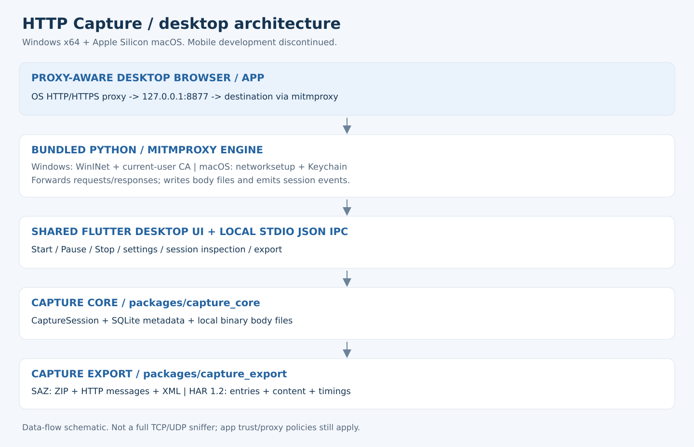

# HTTP Capture

한국어 | [English](README.en.md)

Windows·macOS·Android에서 HTTP/HTTPS를 로컬 수집하고 SAZ/HAR로 내보내는 개발 프로젝트입니다. **실제 소스는 `http-capture/` 한 곳에 있습니다.** ZIP 압축 해제나 `fixes` 덮어쓰기 없이 해당 폴더를 직접 수정·빌드합니다.

## 개발 배경

HTTP Capture는 **Fiddler Classic의 업무·상업적 사용 라이선스 정책 변경과 유료 상용 제품인 Fiddler Everywhere로의 전환 요구에 대응하기 위해 시작한 독립 개발 프로젝트**입니다. 회사 업무와 고객 지원에 필요한 HTTP/HTTPS 수집 및 SAZ/HAR 내보내기에 집중하는 로컬 도구를 직접 구현하는 것이 목적입니다.

정확히는 Fiddler Classic 전체가 유료 제품으로 바뀐 것은 아닙니다. Progress는 2026년 8월 3일 정책 변경을 공지하고, 상업적 사용자의 전환 기한을 2026년 9월 17일로 안내했습니다. Classic은 비상업적 용도로 계속 무료 제공되며, 업무·상업적 사용에는 상용 Fiddler Everywhere로 전환하도록 안내합니다. [공식 전환 안내](https://www.telerik.com/fiddler/fiddler-classic/commercial-use) · [공식 EULA](https://www.telerik.com/purchase/license-agreement/fiddler-enterprise-support)

HTTP Capture는 Progress/Telerik의 공식 제품·포크·제휴 프로젝트가 아닙니다. SAZ 호환을 위한 자체 구현이며, 이 개발 배경이 Fiddler 라이선스의 우회나 모든 Fiddler 기능의 동등 지원을 의미하지 않습니다.

## 전체 구조와 화면 안내

[상세 한국어 안내](docs/architecture.ko.md) · [Detailed English guide](docs/architecture.en.md)

공통 모듈과 플랫폼별 엔진, 세션 저장, SAZ/HAR 표현, 인증서·프록시 복구를 설명합니다. 데스크톱·Android UI 안내 그림과 실제 앱 트래픽 확인 절차도 포함했습니다. 그림은 코드에 근거한 설명용 도식이며 실행 화면 스크린샷이 아닙니다.

## 먼저 볼 파일

- [`http-capture/README.md`](http-capture/README.md): 실행·빌드 및 플랫폼 범위
- [`docs/code-map.md`](docs/code-map.md): 어떤 기능을 어디서 수정하는지
- [`.github/workflows`](.github/workflows): 실제 플랫폼 빌드·검증 절차

공통 모델/저장과 SAZ/HAR는 세 플랫폼이 공유합니다. Windows와 Mac은 같은 데스크톱 화면과 Python/mitmproxy 엔진을 사용하고, OS 설정 어댑터만 나뉩니다. Android는 별도 화면과 Dart 프록시·Kotlin VPN/CA를 사용합니다. iOS 단독 캡처는 구현 전입니다. 모든 패킷이 아니라 프록시를 사용하는 HTTP/HTTPS가 대상입니다.

이전 소스 ZIP과 플랫폼 overlay는 Git 이력에 보존돼 있습니다. 최신 코드의 기준으로 사용하지 마세요. 이번 정리 이후 CI 결과와 실기기 상태는 `docs/code-map.md`의 검증 범위를 확인하세요.

## 앱 다운로드

[HTTP Capture Preview 다운로드 페이지](https://github.com/yongjun94/PacketCollect/releases/tag/v0.1.0-preview.20261028)에서 Windows x64 ZIP, Mac Apple Silicon ZIP, Android APK를 제공합니다. 저장소가 비공개이므로 접근 권한이 있는 GitHub 계정이 필요합니다. 배포 서명/공증이 완료된 정식 버전은 아닙니다. 설치와 기존 APK 업데이트 안내는 Release의 INSTALL.md를 확인하세요.

배포 담당자는 `release/preview.json`에 같은 소스 SHA의 성공한 세 빌드와 artifact ID를 지정합니다. 해당 파일이 main에 반영되면 배포 workflow가 검증 후 초안에 모든 파일을 올리고, 파일 수·크기 확인 후 사전 배포로 게시합니다. 기존 Release를 덮어쓰지 않으며 새 배포는 새 태그를 사용합니다.
