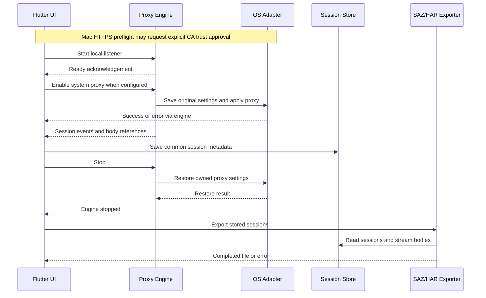
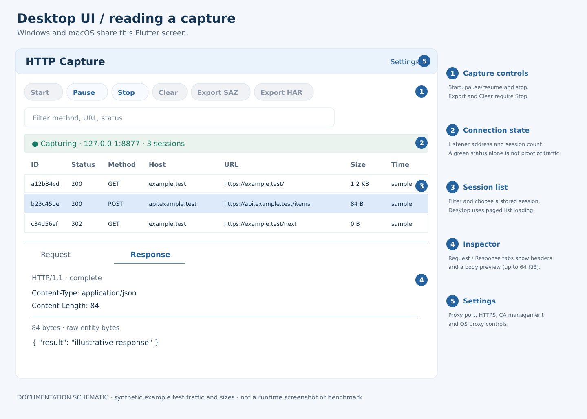

# HTTP Capture — Architecture and UI Guide

> **Current support: Windows x64 / Apple Silicon macOS.** Android development/distribution is discontinued. This guide covers desktop. [Support policy](platform-support.md)

[한국어](architecture.ko.md) · [Project overview](../README.en.md) · [Downloads](https://github.com/yongjun94/PacketCollect/releases/tag/v0.1.0-preview.20261028)

This guide describes the implemented preview, including its limitations. It is not a promise that every item in the original product roadmap is complete. The diagrams are documentation schematics based on the source, not screenshots of a running app. Example sessions and sizes are synthetic.

## Project background: the Fiddler Classic commercial-use transition

HTTP Capture was started as an **independent response to changes in Fiddler Classic's business/commercial-use licensing and the requirement for affected users to move to the paid commercial offering, Fiddler Everywhere**. The goal is a local tool focused on HTTP/HTTPS collection and SAZ/HAR export for workplace troubleshooting and customer support.

More precisely, Fiddler Classic did not become a paid product for every user. Progress announced the change on August 3, 2026, with a September 17, 2026 transition deadline for commercial users. Classic remains free for non-commercial use; business/commercial users are directed to Fiddler Everywhere under a commercial license. [Official transition notice](https://www.telerik.com/fiddler/fiddler-classic/commercial-use) · [Official EULA](https://www.telerik.com/purchase/license-agreement/fiddler-enterprise-support)

HTTP Capture is not an official Progress/Telerik product, fork or affiliated project. SAZ support is independently implemented. This motivation does not imply bypassing Fiddler licensing or feature parity with the Fiddler product family.

## 1. What the application does

HTTP Capture collects proxy-aware HTTP/HTTPS requests and responses on the local device, stores session metadata and body files, and exports captures as SAZ or HAR. Its main purpose is capture and portable evidence collection. It does not include a request composer, AutoResponder, breakpoints, AI analysis, accounts, cloud synchronization or a telemetry upload feature.

It is an HTTP proxy tool rather than a general packet sniffer. Installing a local CA makes eligible HTTPS traffic readable; it does not force applications to use the proxy or bypass their certificate policies.

## 2. The overall architecture

Windows and Mac share the Flutter UI, Python/mitmproxy engine, session store and exporters. OS proxy/CA operations use platform adapters. Diagram arrows describe captured data; the engine forwards network traffic to the destination.

## 3. Desktop: traffic and control are separate

On Windows and Mac, Flutter starts the bundled proxy executable as a child process. Users do not install Python themselves. Commands such as pause, stop, proxy changes and certificate actions use local stdin/stdout JSON messages with acknowledgements. Session events return through the same local process boundary. Settings actions can also run as short-lived helper invocations while capture is stopped.

The mitmproxy addon translates HTTP flows into the common JSON session representation. It streams captured entity bodies to local files and emits metadata events. Flutter receives those events and saves sessions through `SessionStore`. This is separate from the engine's job of forwarding requests/responses to the actual destination.

The default listener is `127.0.0.1:8877`. This preview does not expose a remote-device listener or provide a remote capture configuration UI. System proxy configuration affects only applications that honor it; bypass rules, app-specific networking, VPN policies and unsupported protocols can change what is visible.

### Desktop capture lifecycle

This sequence is an abstraction: OS commands are handled inside the engine/helper, not by a network service. Existing enterprise routes may cause Start to fail safely rather than replace a company's proxy. Unexpected process death, power loss, denied permissions and external settings changes still need recovery handling.

## 4. Windows and Mac OS behavior

| Concern | Windows | macOS |
|---|---|---|
| Routing | Current-user WinINet proxy adapter; enable the system-proxy option in Settings as needed | Start defaults to applying system HTTP/HTTPS proxy settings after the listener is ready |
| HTTPS CA | Explicit user action installs/checks/removes the current installation CA in Current User Root | HTTPS Start preflight checks SSL trust and offers installation with consent; Settings also provides install/check/remove |
| Scope of CA trust | Current user certificate store | Current user default keychain, SSL trust policy |
| Existing corporate configuration | Active explicit proxy or PAC URL blocks takeover; this is not complete WPAD/VPN/WinHTTP/GPO detection | Active HTTP/HTTPS/SOCKS/PAC or automatic proxy discovery blocks takeover |
| Recovery | Saved settings journal and ownership/conflict checks | Saved settings journal, restore checks and retry on next launch; no privileged crash-recovery guardian |
| Distribution | Unsigned development bundle | Ad-hoc signed, no Developer ID signing or notarization |

Only the app-managed CA matching its fingerprint is a removal target. The Mac adapter also uses an installation receipt; an unmanaged, previously imported certificate is not automatically changed or deleted. A CA private key stays local and is not sent to another device or included as a common deployment key.

## 5. Common session and storage model

| Object | Captured content |
|---|---|
| `CaptureSession` | Session/run IDs, source device, start/end timestamps, request, optional response, capture state and error |
| `HttpMessage` | Version, headers, body reference, and request method/URL or response status/reason |
| `Header` | Byte-backed name/value entries represented as an ordered list, allowing duplicates |
| `BodyReference` | Relative path, byte count and completeness flag |
| Additional metadata | Timing, connection and TLS maps; absent data is not evidence of a measured value |

Metadata is stored in `sessions.sqlite`; bodies are stored separately under `bodies/`. SQLite uses WAL with FULL synchronous mode for committed metadata. Pending/receiving sessions are marked interrupted on recovery. Body access checks references and rejects escapes/symlinks; file-based storage avoids embedding large binary bodies in the database.

## 6. SAZ and HAR exporters

Both exporters use the stored common model; Windows and Mac use the same format implementation.

### SAZ

A streaming ZIP writer emits `[Content_Types].xml`, `raw/N_c.txt`, an optional `raw/N_s.txt`, and `raw/N_m.xml`. A missing response remains missing rather than becoming a fabricated response. Metadata includes timestamps, capture state and original representation information.

For Fiddler's HTTP-message representation, HTTP/2 start lines are written as HTTP/1.1 and framing headers are normalized to the stored entity body. Original version/header information is retained in metadata. SAZ therefore preserves captured content with documented normalization; it does not recreate HTTP/2 frames or TLS records.

### HAR 1.2

The exporter writes requests, responses, headers, cookies, query parameters, post data, content and timing objects. Response content uses Base64 where implemented; complete gzip content can be decoded for the HAR content field while raw encoded bytes are retained in `_httpCaptureRawContent`. Other content encodings are not all decoded into a standard browser-ready representation. Binary request post data also uses a capture-specific encoding extension when it cannot be represented as text.

Unmeasured timing phases use `-1`. `_elapsedMs`, `_captureStatus`, `_error` and related extension fields distinguish capture information from standard HAR values. Consumers can ignore custom fields, so inspect them when diagnosing partial data or compressed content.

Exports use a temporary output and finalization path; failure cleanup prevents a failed export from being presented as a completed archive. Export does not imply masking: tokens, cookies and customer information can remain in headers and bodies.

## 7. Desktop UI walkthrough

| Area | How to use it | Current behavior |
|---|---|---|
| Toolbar | Start, Pause/Resume, Stop | Paused traffic is forwarded without normal recording. Stop ends capture and restores owned routing settings. |
| Filter | Enter method, URL or status text | Filters stored metadata; it does not make an app use the proxy. |
| Session table | Select a row | Desktop uses paged loading in a virtualized list; there is no published performance guarantee for a particular session count. |
| Inspector | Choose Request or Response | Shows state, headers and a raw-byte text preview. It is not a full JSON editor, decompression inspector or image viewer. |
| Settings | Configure port, HTTPS and OS/CA actions | Available while stopped; some options are locked while capturing. |
| Export | Stop, then select SAZ or HAR | The desktop selection dialog currently uses Continue for selected-only export and Cancel for all sessions. |

That last selection behavior can be surprising. To verify a full app capture, export **all** sessions. A selected single row is not evidence that the rest of the traffic was absent.

## 8. Checking whether app traffic was captured

1. Stop and clear previous test sessions after saving any needed data.
2. Start capture; trigger a new request in the target app rather than relying on a cached page.
3. Check for new destinations, methods, timestamps and response/body data.
4. Stop and export all sessions.
5. Inspect capture status and errors, not just the green indicator.

A decrypted HTTPS GET/POST and readable response body are stronger evidence than CONNECT metadata alone. A HAR's User-Agent can be a clue, but this preview does not attach a reliable OS process ID to every session. It cannot conclusively assign a request to an application from a User-Agent string alone. An empty capture does not establish that an app made no network requests.

## Current evidence and maintenance

Earlier Windows capture and Fiddler/DevTools imports were user-confirmed. A user-provided Mac HAR demonstrated Safari HTTPS response storage. This does not establish compatibility with every application or later build. [Support policy and validation limits](platform-support.md)

Active work focuses on desktop capture reliability, proxy recovery, large captures/exports, format compatibility, distribution signing and notarization. Android/iOS and remote mobile capture are outside the current roadmap. Retained mobile code is historical.

[Code map](code-map.md) · [Build commands](../http-capture/README.md)
