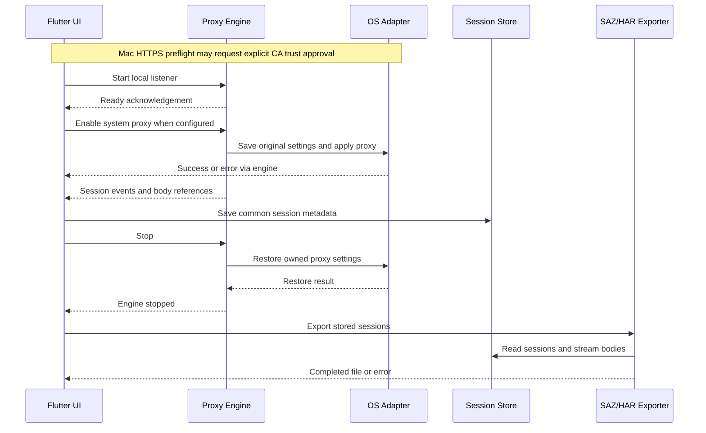

# HTTP Capture — Architecture and UI Guide

[한국어](architecture.ko.md) · [Project overview](../README.en.md) · [Downloads](https://github.com/yongjun94/PacketCollect/releases/tag/v0.1.0-preview.20261028)

This guide describes the implemented preview, including its limitations. It is not a promise that every item in the original product roadmap is complete. The diagrams are documentation schematics based on the source, not screenshots of a running app. Example sessions and sizes are synthetic.

## 1. What the application does

HTTP Capture collects proxy-aware HTTP/HTTPS requests and responses on the local device, stores session metadata and body files, and exports captures as SAZ or HAR. Its main purpose is capture and portable evidence collection. It does not include a request composer, AutoResponder, breakpoints, AI analysis, accounts, cloud synchronization or a telemetry upload feature.

It is an HTTP proxy tool rather than a general packet sniffer. Installing a local CA makes eligible HTTPS traffic readable; it does not force applications to use the proxy or bypass their certificate policies.

## 2. The overall architecture

The two upper lanes are different collection implementations. The lower layers are the same Dart packages. Network requests are forwarded by the proxy engine to the destination; the diagram's downward arrows represent captured session data, not a requirement to send network traffic through SQLite or the UI.

| Layer | Implementation | Why it is separated |
|---|---|---|
| Capture engine | Python/mitmproxy on Windows/Mac; Dart local proxy with Kotlin VPN/CA integration on Android | Traffic routing, TLS handling and OS APIs differ. |
| Capture Core | Dart `packages/capture_core` | Defines the common session model and local store independently of a particular proxy. |
| Capture Export | Dart `packages/capture_export` | Uses stored sessions to create the same file formats on every supported platform. |
| UI | Shared Windows/Mac Flutter screen; separate Android Flutter screen | Desktop tables and mobile VPN/CA workflows have different interaction needs. |
| Platform adapters | WinINet/current-user certificate store; macOS networksetup/Keychain; Android VpnService/Keystore | Keeps OS configuration operations out of exporter and model code. |

“One Flutter project” does **not** mean one capture engine for every OS. `apps/capture_app/lib/main.dart` selects the Android screen on Android and the shared desktop screen otherwise. The current supported runtime targets are Windows, Apple Silicon Mac and Android; the presence of other Flutter runner files is not proof of a working capture implementation.

## 3. Desktop: traffic and control are separate

On Windows and Mac, Flutter starts the bundled proxy executable as a child process. Users do not install Python themselves. Commands such as pause, stop, proxy changes and certificate actions use local stdin/stdout JSON messages with acknowledgements. Session events return through the same local process boundary. Settings actions can also run as short-lived helper invocations while capture is stopped.

The mitmproxy addon translates HTTP flows into the common JSON session representation. It streams captured entity bodies to local files and emits metadata events. Flutter receives those events and saves sessions through `SessionStore`. This is separate from the engine's job of forwarding requests/responses to the actual destination.

The default listener is `127.0.0.1:8877`. This preview does not expose a remote-device listener or provide a remote capture configuration UI. System proxy configuration affects only applications that honor it; bypass rules, app-specific networking, VPN policies and unsupported protocols can change what is visible.

### Desktop capture lifecycle

This sequence is an abstraction: OS commands are handled inside the engine/helper, not by a network service. Existing enterprise routes may cause Start to fail safely rather than replace a company's proxy. Unexpected process death, power loss, denied permissions and external settings changes still need recovery handling.

## 4. Windows and Mac OS behavior

| Concern | Windows | macOS |
|---|---|---|
| Routing | Current-user WinINet proxy adapter; enable the system-proxy option in Settings as needed | Start defaults to applying system HTTP/HTTPS proxy settings after the listener is ready |
| HTTPS CA | Explicit user action installs/checks/removes the current installation CA in Current User Root | HTTPS Start preflight checks SSL trust and offers installation with consent; Settings also provides install/check/remove |
| Scope of CA trust | Current user certificate store | Current user default keychain, SSL trust policy |
| Existing corporate configuration | Active explicit proxy or PAC URL blocks takeover; this is not complete WPAD/VPN/WinHTTP/GPO detection | Active HTTP/HTTPS/SOCKS/PAC or automatic proxy discovery blocks takeover |
| Recovery | Saved settings journal and ownership/conflict checks | Saved settings journal, restore checks and retry on next launch; no privileged crash-recovery guardian |
| Distribution | Unsigned development bundle | Ad-hoc signed, no Developer ID signing or notarization |

Only the app-managed CA matching its fingerprint is a removal target. The Mac adapter also uses an installation receipt; an unmanaged, previously imported certificate is not automatically changed or deleted. A CA private key stays local and is not sent to another device or included as a common deployment key.

## 5. Android is a proxy-assisted VPN preview

The Android implementation consists of a Flutter UI, a Dart HTTP/TLS proxy, and Kotlin code for VPN lifecycle, CA operations and file export. `MethodChannel('dev.httpcapture/android')` connects Flutter to those native operations.

`CaptureService` creates a temporary VPN network with an HTTP proxy hint for `127.0.0.1:8877`. It does **not** implement a general TCP/UDP packet-processing stack or a tun-to-socket bridge. Proxy-aware apps may send traffic through the local proxy; apps that ignore the hint are not guaranteed to be captured. Starting this service can replace an existing VPN.

The native CA key is generated locally in Android Keystore. The public certificate can be saved to Downloads and the app can open security settings. Android still requires the user's system-level certificate installation steps; the ordinary app cannot silently install or remove trusted CAs. User CA distrust and certificate pinning are not bypassed.

Stopping releases the VPN proxy before the Dart listener closes. Switching to another app keeps capture running. Back/explicit exit, task removal, revoke and the native heartbeat watchdog participate in cleanup. These are tested paths, not a guarantee against every OS/device failure. Wi-Fi proxy settings are not persistently rewritten.

## 6. Common session and storage model

| Object | Captured content |
|---|---|
| `CaptureSession` | Session/run IDs, source device, start/end timestamps, request, optional response, capture state and error |
| `HttpMessage` | Version, headers, body reference, and request method/URL or response status/reason |
| `Header` | Byte-backed name/value entries represented as an ordered list, allowing duplicates |
| `BodyReference` | Relative path, byte count and completeness flag |
| Additional metadata | Timing, connection and TLS maps; absent data is not evidence of a measured value |

Metadata is stored in `sessions.sqlite`; bodies are stored separately under `bodies/`. SQLite uses WAL with FULL synchronous mode for committed metadata. Pending/receiving sessions are marked interrupted on recovery. Body access checks references and rejects escapes/symlinks; file-based storage avoids embedding large binary bodies in the database.

The representation is an HTTP entity representation, **not a byte-for-byte TCP/TLS wire recording**. The desktop engine has already parsed HTTP framing. Android uses parsed header APIs, so original header casing and global order cannot be guaranteed even though the common model can preserve ordered entries and duplicate values.

Android currently caps captured body storage at 64 MiB per request/response side and marks truncation as partial while continuing forwarding. The desktop UI reads only the first 64 KiB for a body preview. Neither value is a measured throughput or memory benchmark. Full stored data is exported independently of the preview.

## 7. SAZ and HAR exporters

Both exporters use the stored common model; there is no separate Windows/Mac/Android format implementation.

### SAZ

A streaming ZIP writer emits `[Content_Types].xml`, `raw/N_c.txt`, an optional `raw/N_s.txt`, and `raw/N_m.xml`. A missing response remains missing rather than becoming a fabricated response. Metadata includes timestamps, capture state and original representation information.

For Fiddler's HTTP-message representation, HTTP/2 start lines are written as HTTP/1.1 and framing headers are normalized to the stored entity body. Original version/header information is retained in metadata. SAZ therefore preserves captured content with documented normalization; it does not recreate HTTP/2 frames or TLS records.

### HAR 1.2

The exporter writes requests, responses, headers, cookies, query parameters, post data, content and timing objects. Response content uses Base64 where implemented; complete gzip content can be decoded for the HAR content field while raw encoded bytes are retained in `_httpCaptureRawContent`. Other content encodings are not all decoded into a standard browser-ready representation. Binary request post data also uses a capture-specific encoding extension when it cannot be represented as text.

Unmeasured timing phases use `-1`. `_elapsedMs`, `_captureStatus`, `_error` and related extension fields distinguish capture information from standard HAR values. Consumers can ignore custom fields, so inspect them when diagnosing partial data or compressed content.

Exports use a temporary output and finalization path; failure cleanup prevents a failed export from being presented as a completed archive. Export does not imply masking: tokens, cookies and customer information can remain in headers and bodies.

## 8. Desktop UI walkthrough

| Area | How to use it | Current behavior |
|---|---|---|
| Toolbar | Start, Pause/Resume, Stop | Paused traffic is forwarded without normal recording. Stop ends capture and restores owned routing settings. |
| Filter | Enter method, URL or status text | Filters stored metadata; it does not make an app use the proxy. |
| Session table | Select a row | Desktop uses paged loading in a virtualized list; there is no published performance guarantee for a particular session count. |
| Inspector | Choose Request or Response | Shows state, headers and a raw-byte text preview. It is not a full JSON editor, decompression inspector or image viewer. |
| Settings | Configure port, HTTPS and OS/CA actions | Available while stopped; some options are locked while capturing. |
| Export | Stop, then select SAZ or HAR | The desktop selection dialog currently uses Continue for selected-only export and Cancel for all sessions. |

That last selection behavior can be surprising. To verify a full app capture, export **all** sessions. A selected single row is not evidence that the rest of the traffic was absent.

## 9. Android UI walkthrough

Enable HTTPS in the settings dialog if needed, prepare/install the CA through Android, then press Start and approve VPN use. Switch to the target app and trigger a fresh request. Return, Stop and export SAZ/HAR through the system document picker. A document provider may be backed by cloud storage, so choose a destination appropriate for the data.

`Test HTTP` and `Test TLS` exercise device-local origins. A successful self-test proves that path; it does not prove that every external app trusts the CA or uses the proxy. The current mobile session list shows a filtered window of up to 200 stored sessions, and its detail dialog displays headers and body size rather than the desktop body preview. Shared exports iterate stored sessions, not only those visible rows.

The Android UI is not currently a pixel-identical mobile version of the desktop UI. The schematic abbreviates labels for readability and does not claim an additional app selector, process inspector or packet view.

## 10. Checking whether app traffic was captured

1. Stop and clear previous test sessions after saving any needed data.
2. Start capture; trigger a new request in the target app rather than relying on a cached page.
3. Check for new destinations, methods, timestamps and response/body data.
4. Stop and export all sessions.
5. Inspect capture status and errors, not just the green indicator.

A decrypted HTTPS GET/POST and readable response body are stronger evidence than CONNECT metadata alone. A HAR's User-Agent can be a clue, but this preview does not attach a reliable OS process ID to every session. It cannot conclusively assign a request to an application from a User-Agent string alone. An empty capture does not establish that an app made no network requests.

## 11. Supported scope and evidence

| Area | Evidence and limit |
|---|---|
| Shared source cleanup | Windows build [40652755920](https://github.com/yongjun94/PacketCollect/actions/runs/40652755920) and Mac build [40652755909](https://github.com/yongjun94/PacketCollect/actions/runs/40652755909) passed build/automated checks. |
| Android | Build/emulator run [40652755751](https://github.com/yongjun94/PacketCollect/actions/runs/40652755751) passed APK, HTTP/HTTPS and VPN-release checks on API35 x86_64. Physical-device CA installation remains separate. |
| Manual compatibility | Earlier Windows capture and Fiddler/DevTools import were user-confirmed. A user-provided Mac HAR contained Safari HTTPS 200 plus HTML. New source-layout builds still need physical-device acceptance. |
| Protocols | Desktop HTTP/1.1 and tested HTTP/2 paths; Android HTTP/1.1-oriented proxy. WebSocket payload capture and HTTP/3/QUIC are not supplied by this preview. |
| Other platforms | No iOS standalone engine or Intel Mac release package. Remote/mobile-to-desktop capture UI is not implemented. |

Android engine tests live in `test/android` and are run on the Android Linux CI host; desktop UI/IPC tests live in `test/desktop`. Android TLS fixtures failed macOS native trust validation when initially mixed into the desktop suite. The suites were separated by their actual engine target, not made to bypass TLS validation. Mac traffic is collected by the separate Python engine.

## 12. Source map and maintenance

The editable project is `http-capture/`. The former source ZIP and overlay folders are retired to Git history. Change `packages/capture_export` for format behavior, `capture_core` for model/storage, `lib/app.dart` for the shared desktop screen, and platform adapters for OS routing/trust.

Android's reviewed Kotlin sources live in `engines/android_vpn`; `scripts/prepare_android.py` generates a pinned Flutter runner without overwriting reviewed Dart source. Regenerate that runner after native source edits. Desktop packaging is shared in `scripts/build_desktop.py`. See [the code map](code-map.md), [English installation guide](../release/INSTALL.en.md) and [CI workflows](../.github/workflows).

Future work includes stable release signing/update keys, broader real-device acceptance, enterprise upstream/PAC/VPN compatibility, richer mobile inspection, optional explicitly marked redaction, and separately scoped native mobile packet engines. These are roadmap items, not current download features.

### Maintaining the illustrations

The checked-in SVGs are generated from `docs/generate_figures.py` and can be regenerated with Python 3 plus the Inkscape command-line tool. The script also renders PNG previews for visual review. These are documentation tooling dependencies, not application runtime requirements. Keep diagrams aligned with implemented controls and mark synthetic values explicitly; do not substitute customer capture screenshots.
