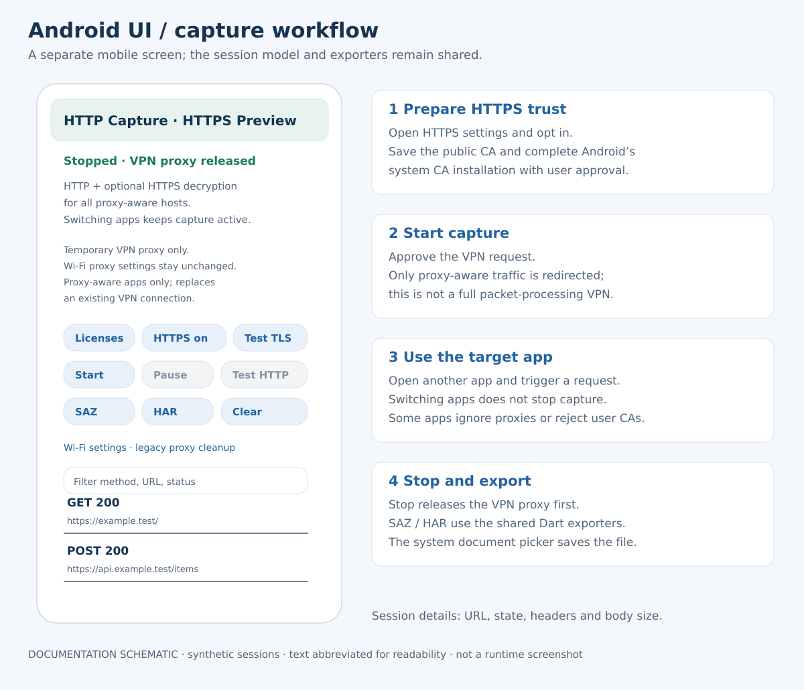

# HTTP Capture — 전체 구조와 UI 안내

[English](architecture.en.md) · [프로젝트 첫 화면](../README.md) · [실행판 다운로드](https://github.com/yongjun94/PacketCollect/releases/tag/v0.1.0-preview.20261028)

이 문서는 현재 구현된 Preview를 설명합니다. 초기 요구사항 전체가 완성되었다는 뜻은 아닙니다. 아래 UI 그림은 실제 코드에 근거한 설명용 도식이며 실행 화면을 촬영한 스크린샷이 아닙니다. 예시 URL·크기·세션은 가상 데이터입니다.

## 개발 배경: Fiddler Classic 상업적 이용 정책 변경

HTTP Capture는 **Fiddler Classic의 업무·상업적 사용 라이선스 정책 변경과 유료 상용 제품인 Fiddler Everywhere로의 전환 요구에 대응하기 위해 시작한 독립 개발 프로젝트**입니다. 회사 업무와 고객 지원에 필요한 HTTP/HTTPS 수집 및 SAZ/HAR 내보내기에 집중하는 로컬 도구를 직접 구현하는 것이 목적입니다.

정확히는 Fiddler Classic 전체가 유료 제품으로 바뀐 것은 아닙니다. Progress는 2026년 8월 3일 정책 변경을 공지하고, 상업적 사용자의 전환 기한을 2026년 9월 17일로 안내했습니다. Classic은 비상업적 용도로 계속 무료 제공되며, 업무·상업적 사용에는 상용 Fiddler Everywhere로 전환하도록 안내합니다. [공식 전환 안내](https://www.telerik.com/fiddler/fiddler-classic/commercial-use) · [공식 EULA](https://www.telerik.com/purchase/license-agreement/fiddler-enterprise-support)

HTTP Capture는 Progress/Telerik의 공식 제품·포크·제휴 프로젝트가 아닙니다. SAZ 호환을 위한 자체 구현이며, 이 개발 배경이 Fiddler 라이선스의 우회나 모든 Fiddler 기능의 동등 지원을 의미하지 않습니다.

## 1. 프로그램의 목적과 수집 범위

HTTP Capture는 HTTP/HTTPS 요청과 응답을 로컬에 저장하고 SAZ/HAR로 내보내는 도구입니다. 복잡한 진단이나 요청 수정, AI 분석보다 캡처와 파일 생성에 집중합니다. Composer, AutoResponder, Breakpoints, 로그인, 클라우드 동기화, 원격 분석 전송은 제공하지 않습니다.

이 프로그램은 모든 패킷을 읽는 드라이버가 아니라 **프록시를 이용하는 HTTP/HTTPS 수집기**입니다. CA 설치는 수집 가능한 HTTPS의 복호화를 돕지만, 앱의 프록시 무시·사용자 CA 불신·인증서 고정을 해결하지는 않습니다.

## 2. 전체 아키텍처

위쪽 두 영역은 수집 방식이 다르고 아래쪽 공통 모듈은 같습니다. 그림의 아래 방향 화살표는 수집된 세션 데이터 흐름입니다. 실제 인터넷 요청은 엔진에서 목적지 서버로 전달되며 SQLite나 UI를 거쳐 인터넷에 나가는 것은 아닙니다.

| 영역 | 실제 구현 | 분리 이유 |
|---|---|---|
| Capture Engine | Windows/Mac: Python·mitmproxy, Android: Dart 프록시·Kotlin VPN/CA 연동 | OS의 라우팅·TLS·인증서 API가 다릅니다. |
| Capture Core | `packages/capture_core` | 세션 모델과 저장 기능을 엔진과 독립적으로 유지합니다. |
| Capture Export | `packages/capture_export` | 같은 세션으로 같은 SAZ/HAR 생성 코드를 사용합니다. |
| UI | Windows/Mac 공통 Flutter 화면, Android 별도 Flutter 화면 | 데스크톱 표와 모바일 VPN·인증서 절차의 사용성이 다릅니다. |
| OS Adapter | Windows WinINet/사용자 인증서 저장소, Mac networksetup/Keychain, Android VpnService/Keystore | Exporter나 모델 코드에 OS 설정 작업을 섞지 않습니다. |

Flutter 프로젝트가 하나라는 말이 모든 OS의 캡처 엔진까지 같다는 뜻은 아닙니다. `apps/capture_app/lib/main.dart`가 Android 화면과 공통 데스크톱 화면을 선택합니다. iOS runner 파일이 있더라도 독립 캡처 엔진이 구현되었다는 뜻은 아닙니다.

## 3. Windows/Mac의 처리 과정

1. Flutter가 번들에 포함된 Python 프록시 실행 파일을 자식 프로세스로 시작합니다. 최종 사용자는 Python을 별도 설치하지 않습니다.
2. 엔진이 기본 `127.0.0.1:8877` 리스너를 준비하고 Ready를 알립니다.
3. 설정에 따라 OS 프록시를 적용합니다. Mac HTTPS는 이보다 먼저 CA 신뢰를 확인하고 필요하면 설치 동의를 요청합니다.
4. 브라우저·앱이 프록시를 사용하면 mitmproxy가 요청·응답을 전달하며 Body 파일과 세션 이벤트를 생성합니다.
5. Flutter가 공통 모델로 세션을 저장하고 목록을 갱신합니다.
6. Stop에서는 관리 중인 프록시 설정을 복원한 뒤 리스너를 종료합니다.
7. 저장한 세션과 Body 파일을 읽어 SAZ/HAR를 생성합니다.

UI와 엔진의 통신은 로컬 표준 입출력의 JSON 명령·이벤트·응답입니다. 인터넷으로 제어 데이터를 보내는 API가 아닙니다. 캡처 중이 아니어도 설정용 짧은 엔진 실행으로 인증서 상태 등을 확인할 수 있습니다.

Windows는 현재 사용자 WinINet 설정을 사용하며 시스템 프록시 옵션을 필요에 따라 켭니다. Mac은 Start 시 시스템 HTTP/HTTPS 프록시 적용이 기본입니다. Windows는 활성 명시적 프록시/PAC URL을, Mac은 활성 HTTP/HTTPS/SOCKS/PAC·자동 검색을 발견하면 덮어쓰기를 거부합니다. Windows의 검사가 WPAD·VPN·WinHTTP·GPO 전체를 판단하는 것은 아닙니다.

## 4. Android는 어떤 방식인가요?

Android는 Flutter UI와 Dart 로컬 프록시, Kotlin의 VPN·CA·파일 내보내기 코드를 사용합니다. Flutter와 Kotlin은 `MethodChannel('dev.httpcapture/android')`로 연결합니다.

현재 VpnService는 임시 VPN 네트워크에 HTTP 프록시 힌트를 지정합니다. **TCP/UDP 패킷 처리 스택이나 tun-to-socket 엔진을 구현한 상태가 아닙니다.** 프록시를 따르는 앱이 수집 대상이며 기존 VPN을 대체할 수 있습니다.

CA 개인키는 Android Keystore에 생성합니다. 공개 인증서를 Downloads에 저장하고 보안 설정을 여는 일은 앱이 돕지만, Android 시스템에서 CA를 설치하는 사용자 확인 과정은 필요합니다. 일반 앱이 이를 조용히 설치·삭제하거나 인증서 고정을 우회하지 않습니다.

Stop은 VPN 프록시 해제를 확인한 뒤 Dart 리스너를 닫습니다. 다른 앱으로 전환해도 캡처는 유지됩니다. 뒤로 가기/명시적 종료, 작업 제거, VPN 승인 철회, heartbeat 감시가 해제 경로에 참여합니다. 모든 기기·비정상 상황을 보장하는 것은 아닙니다. Wi-Fi 프록시는 지속적으로 변경하지 않습니다.

## 5. 공통 모델과 로컬 저장

| 데이터 | 보존 내용 |
|---|---|
| CaptureSession | 세션/실행 ID, 소스 장치, 시작/종료 시각, 요청·선택적 응답, 상태·오류 |
| HttpMessage | HTTP 버전, Header 목록, Body 참조, Method/URL 또는 Status/Reason |
| Header | 이름·값의 바이트 표현, 중복을 허용하는 순서 있는 목록 |
| BodyReference | 상대 파일 경로, 기록된 바이트 수, 완전 수집 여부 |
| 부가 메타데이터 | timing·connection·TLS map. 값이 없으면 실제 측정으로 보지 않습니다. |

세션 메타데이터는 `sessions.sqlite`, Body는 `bodies/` 아래 별도 파일에 저장합니다. SQLite는 WAL과 FULL synchronous 설정을 사용하며, 종료되지 않은 receiving/pending 세션은 재시작 시 interrupted로 처리합니다. Body 참조는 경로와 파일 길이를 검사하고 외부 경로·심볼릭 링크를 거부합니다.

저장 형식은 파싱된 HTTP entity 표현입니다. TCP/TLS wire의 모든 바이트를 그대로 기록한 파일이 아닙니다. Android는 파싱된 Header API를 사용하므로 공통 모델이 순서를 표현할 수 있더라도 원래 casing·전역 순서를 모두 복원할 수는 없습니다.

현재 Android Body 저장 제한은 요청/응답 각각 64 MiB이며 초과하면 partial로 표시하고 전달은 계속합니다. 데스크톱 본문 미리보기는 처음 64 KiB까지 읽습니다. 이는 구현상의 제한이며 성능 측정 결과가 아닙니다. 내보내기는 미리보기와 별도로 저장된 데이터를 읽습니다.

## 6. SAZ/HAR 생성과 데이터 표현

두 형식은 모든 플랫폼에서 같은 Dart Exporter를 사용합니다.

**SAZ**는 `[Content_Types].xml`과 `raw/N_c.txt`, 응답이 있을 때 `raw/N_s.txt`, 메타데이터 `raw/N_m.xml`을 생성하는 ZIP입니다. 없는 응답을 임의로 만들어 넣지 않습니다. Fiddler가 읽는 메시지 표현에 맞춰 HTTP/2 시작 줄을 HTTP/1.1로 표현하고 프레이밍 Header를 정규화하며 원래 버전과 Header 정보는 메타데이터에 보존합니다. HTTP/2 프레임이나 TLS 레코드 재생 형식은 아닙니다.

**HAR 1.2**에는 요청·응답·Header·Cookie·queryString·postData·content·timings를 기록합니다. 응답 본문은 Base64 표현을 사용하며 완전한 gzip은 content용으로 풀고 `_httpCaptureRawContent`에 인코딩된 원본을 남길 수 있습니다. 모든 압축 인코딩을 브라우저용 본문으로 해제하는 것은 아닙니다. 텍스트가 아닌 요청 postData도 확장 필드를 사용합니다.

측정하지 않은 시간 단계는 `-1`로 표시하고 `_elapsedMs`, `_captureStatus`, `_error` 등의 확장 정보로 수집 상태를 구분합니다. 내보내기 임시 파일과 완료 처리를 분리하지만, 내보냈다는 사실이 민감정보 마스킹을 뜻하지는 않습니다. Cookie·Authorization·고객 정보가 남을 수 있습니다.

## 7. 데스크톱 UI 읽기

| 화면 영역 | 사용 방법과 현재 동작 |
|---|---|
| Start / Pause / Stop | 시작·기록 일시정지·종료. Pause 중에도 트래픽은 전달됩니다. |
| 상태 표시줄 | 리스너 주소와 세션 수를 표시합니다. 초록색만으로 실제 수집을 판단하지 않습니다. |
| Filter | Method·URL·Status 문자열로 저장 목록을 필터링합니다. 앱의 라우팅을 바꾸는 필터는 아닙니다. |
| 세션 표 | 선택한 세션을 아래에 표시합니다. 페이지 단위 데이터 조회와 가상 목록을 사용하지만 세션 수별 성능 보장치는 없습니다. |
| Request / Response | 상태·Header·Body 미리보기. 완전한 JSON 편집기·이미지 뷰어·압축 해제 Inspector는 아닙니다. |
| Settings | 포트·HTTPS·인증서·OS 프록시 기능. 캡처가 없어도 열 수 있으며 일부 값은 캡처 중 잠깁니다. |
| Export SAZ / HAR | Stop 후 저장합니다. 현재 선택 확인창의 Continue는 선택 세션만, Cancel은 전체 세션 내보내기입니다. |

선택 세션만 내보내면 HAR 한 항목만 보일 수 있습니다. 앱 전체 통신을 확인할 때는 전체 세션을 내보내세요.

## 8. Android UI와 사용 순서

필요하면 HTTPS 설정에서 복호화를 켜고 공개 CA 준비·시스템 설치를 진행합니다. Start와 VPN 승인을 마친 뒤 대상 앱으로 전환해 새 요청을 발생시킵니다. 돌아와 Stop 후 SAZ/HAR를 내보냅니다. 시스템 문서 선택기에 클라우드 제공자가 보일 수 있으므로 데이터에 적합한 위치를 고릅니다.

Test HTTP/Test TLS는 장치 로컬 테스트 서버와 실제 요청을 주고받는 확인 기능입니다. 이 성공이 모든 외부 앱의 CA 신뢰나 프록시 사용을 입증하지는 않습니다. 현재 모바일 화면은 필터링된 최대 200개 저장 세션을 표시하며 상세창은 Header와 Body 크기를 보여줍니다. 데스크톱과 같은 본문 미리보기는 없습니다. Exporter는 화면에 보이는 항목만이 아니라 저장된 세션을 순회합니다.

Android 화면은 데스크톱 화면을 그대로 축소한 것이 아닙니다. 설명 그림에 없는 앱별 선택·프로세스 추적·패킷 뷰 기능이 있다고 해석해서는 안 됩니다.

## 9. 실제 앱 요청이 잡혔는지 확인하기

1. 기존 데이터를 저장한 뒤 Stop과 Clear로 테스트를 분리합니다.
2. Start 후 대상 앱에서 새로고침·검색 등 새 요청을 만듭니다.
3. 새 URL·시각·응답·Body와 수집 상태를 확인합니다.
4. Stop 후 전체 세션을 내보냅니다.

CONNECT 한 줄보다 실제 HTTPS GET/POST와 읽을 수 있는 응답 본문이 복호화의 근거가 됩니다. User-Agent는 참고 정보이지만 이 Preview에는 모든 세션을 실제 실행 프로세스 ID와 연결하는 기능이 없습니다. User-Agent만으로 요청 앱을 단정할 수 없습니다. 비어 있는 캡처도 앱에 통신이 없었다는 증거는 아닙니다.

## 10. 검증 수준과 지원 제한

- 구조 정리 후 [Windows 빌드](https://github.com/yongjun94/PacketCollect/actions/runs/40652755920), [Mac 빌드](https://github.com/yongjun94/PacketCollect/actions/runs/40652755909)가 빌드·자동 검증에 성공했습니다.
- [Android 빌드·API35 에뮬레이터](https://github.com/yongjun94/PacketCollect/actions/runs/40652755751)에서 HTTP/HTTPS와 중지·종료 시 VPN 프록시 해제를 확인했습니다. 실제 사용자 CA 설치와 기기별 검증은 별도입니다.
- 이전 Windows 버전은 사용자가 Fiddler/DevTools 가져오기를 확인했습니다. Mac 사용자 HAR에서도 Safari HTTPS 응답과 HTML 저장을 확인했습니다. 새 구조의 모든 실기기 동작을 확인한 것은 아닙니다.
- 데스크톱은 HTTP/1.1과 검증한 HTTP/2 경로를 다룹니다. Android 프록시는 HTTP/1.1 중심입니다. WebSocket payload·HTTP/3/QUIC·iOS 단독 캡처·Intel Mac 배포·원격 모바일 프록시 UI는 현재 제공 범위가 아닙니다.
- 강제 종료 직후 Mac 프록시 복원을 보장하는 상주 권한 helper는 없습니다. 재실행 복구, 승인 거부, 외부 설정 변경을 별도로 고려해야 합니다.

테스트도 `test/desktop`과 `test/android`로 나눕니다. 통합 초기에 Android TLS fixture가 Mac의 네이티브 신뢰 검증에서 실패했습니다. 이를 Mac 엔진 지원으로 간주하지 않고 실제 대상별로 실행 범위를 나눴으며 TLS 검증을 끄지 않았습니다. Mac의 실제 수집 엔진은 Python/mitmproxy입니다.

## 11. 유지보수와 후속 개발

소스는 `http-capture/`에 있으며 ZIP·overlay는 Git 이력으로 이동했습니다. 모델/저장은 `capture_core`, 파일 형식은 `capture_export`, 공통 데스크톱 UI는 `lib/app.dart`, OS 설정은 각 adapter를 수정합니다. Android Kotlin 원본은 `engines/android_vpn`에 있고 `scripts/prepare_android.py`가 Dart 원본을 덮어쓰지 않고 runner를 생성합니다.

[코드 위치 안내](code-map.md), [설치 안내](../release/INSTALL.md), [영문 설치 안내](../release/INSTALL.en.md)를 함께 참고하세요. 배포 서명·업데이트 키, 기업 upstream/PAC/VPN, 실기기 검증 확대, 모바일 Inspector, 선택적 마스킹, 독립 패킷 엔진은 후속 범위입니다.

### 그림 수정 방법

`docs/generate_figures.py`가 SVG 원본과 검토용 PNG를 생성합니다. Python 3와 Inkscape 명령줄 도구가 있는 환경에서 실행합니다. 이는 문서 작성 도구이며 앱 실행 의존성이 아닙니다. 실제 구현과 버튼 상태를 맞추고 가상 데이터를 명시하며 고객 트래픽 화면으로 대체하지 않습니다.
